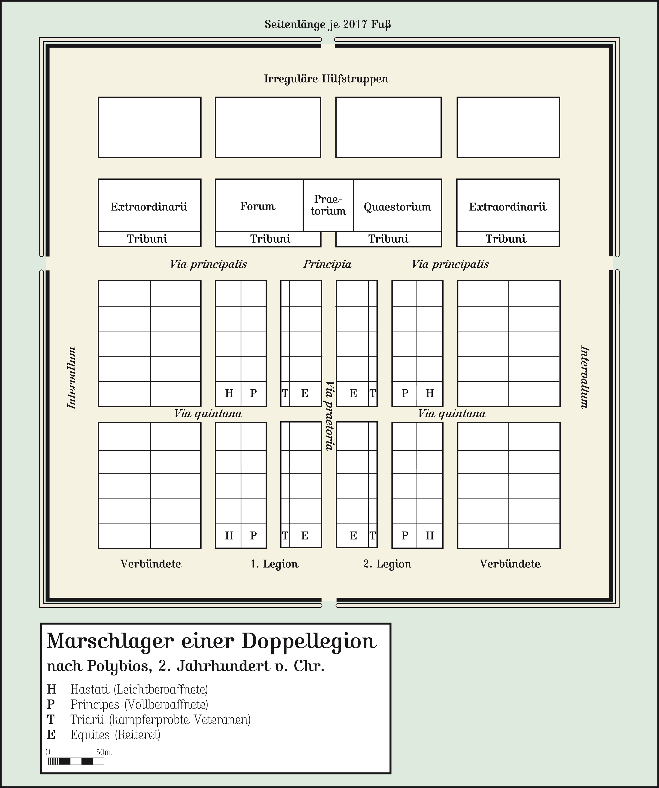

# castra

<p align="center">
  
</p>
<p align="center"><sub>The plan every Roman marching camp was built to, after Polybius. Image: <a href="https://commons.wikimedia.org/wiki/File:Marschlager_nach_Polybios.png">Mediatus</a>, <a href="https://creativecommons.org/licenses/by-sa/3.0/">CC BY-SA 3.0</a>, via Wikimedia Commons, unmodified.</sub></p>

*Castra* is Latin for the camp a Roman legion built at the end of every day's march and tore down again the next morning. It was built to one plan and looked the same every time, so every soldier knew exactly where his tent was (Polybius, *Histories* 6.41). castra does the same for your devcontainer.

castra builds a devcontainer from your project's `.devcontainer` folder, runs it on Podman (or Docker) on your own machine, and lets you in over SSH with your ssh-agent forwarded. That's all it does.

> **Status: early.** Tested on Linux with rootless Podman 5 and with Docker 29 (Fedora 43, SELinux enforcing). macOS is not tested yet ([#1](https://github.com/mischavandenburg/castra/issues/1)). There is no license yet ([#2](https://github.com/mischavandenburg/castra/issues/2)), which means you may read the code but not reuse it until one is chosen.

## Why

[DevPod](https://github.com/loft-sh/devpod) does this job and much more: cloud providers, Kubernetes, IDE launchers, a desktop app. It stopped being maintained in 2025. If all you do is run devcontainers locally and SSH into them, castra is that one path, kept small.

## Install

You need four things: Go 1.26 or newer, Podman (or Docker), the OpenSSH client, and Microsoft's [devcontainer CLI](https://github.com/devcontainers/cli) on your `PATH`. castra uses that CLI for all the devcontainer.json work and does not install it for you, so you update it the same way you update your other tools.

With [mise](https://mise.jdx.dev):

```console
mise use -g node@lts npm:@devcontainers/cli
go install github.com/mischavandenburg/castra@latest
castra doctor
```

Without mise, install the CLI with npm instead: `npm install -g @devcontainers/cli`.

`castra doctor` checks everything castra needs. Every `castra up` checks the CLI first: if it is missing, does not run, or is older than 0.89.0 (the oldest release castra is verified with), castra stops and tells you the command that fixes it. Upgrading is `mise up npm:@devcontainers/cli`.

## Use

```console
cd my-project            # a folder with .devcontainer/devcontainer.json
castra up                # build and start the container
castra ssh my-project    # open a shell inside it
```

The workspace is named after the folder (`my-project`), and inside the container your code is at `/workspaces/my-project`.

Leave out the name and castra shows a menu of your workspaces (arrow keys or j/k, Enter, a number to jump, q to quit). With only one workspace it goes straight in.

```console
castra ssh
```

Run a single command instead of a shell:

```console
castra ssh my-project -- git status
```

See your workspaces and whether their containers are running (`--json` for scripts):

```console
castra ls
```

Rebuild from scratch after you change the Dockerfile or devcontainer.json:

```console
castra up my-project --recreate
```

Stop a workspace's container when you are done for now. Open sessions end; nothing is rebuilt: `castra up` or `castra ssh` starts the same container again. Without a name it shows the menu.

```console
castra stop my-project
```

Delete a workspace when you are done with it. castra asks first (`-y` skips the question), then removes the container and its SSH host entry. Your folder, the images and any named volumes stay. Without a name it shows the menu.

```console
castra delete my-project
```

castra also adds a host to your SSH config, so anything that speaks SSH works too:

```console
ssh my-project.castra
scp notes.txt my-project.castra:
rsync -a ./data/ my-project.castra:/workspaces/my-project/data/
```

## Dotfiles

Put your dotfiles repository in `~/.config/castra/config.yaml`:

```yaml
dotfiles:
  repo: git@github.com:you/dotfiles.git
```

On the first `up` of each new container, castra clones it to `~/dotfiles` inside the container and runs the first of `install.sh`, `install`, `bootstrap.sh`, `bootstrap`, `setup.sh`, `setup` it finds. The clone goes over SSH with your forwarded agent, so a private repository works without copying any key into the container. Set `dotfiles.install` to run a different command instead.

`castra config show` prints the settings in your config file, and `castra config path` prints where that file is.

## How it works

- **Building** is done by Microsoft's devcontainer CLI. Features, lifecycle commands, mounts and `runArgs` behave as the spec says.
- **SSH** runs over `podman exec -i`. castra copies itself into the container once and runs a small SSH server there for each connection. castra opens no port, on the host or in the container.
- **Your agent** is forwarded per session. Inside a session, `SSH_AUTH_SOCK` points at a socket that exists only while the session does. Your host's socket is never mounted into the container.
- **No keys** of castra's own, as in DevPod. The containers are on your own machine and the only way in is the engine's `exec`, so the server asks for no key and OpenSSH does not check its host key.
- **Port forwarding** works both ways, like DevPod: `ssh -L 8080:localhost:8080 my-project.castra` reaches a server in the container, and `ssh -R` makes one of yours reachable from inside it.
- **The environment** inside a session is the container's own, plus devcontainer.json's `remoteEnv`, plus `REMOTE_CONTAINERS=true`, `CASTRA=true` and `CASTRA_WORKSPACE=<name>`. `REMOTE_CONTAINERS` is what VS Code and DevPod set, and many dotfiles check it to know they run in a devcontainer, for example to leave `SSH_AUTH_SOCK` alone. Lifecycle commands get the same three variables.

castra keeps its files in `~/.ssh/castra/` (one Host block per workspace), `~/.local/state/castra/` (one record per workspace) and `~/.config/castra/config.yaml`. The only change it makes outside those is one `Include` line at the top of `~/.ssh/config`.

What the container can and cannot reach, and how to report a problem: [SECURITY.md](SECURITY.md).

## Testing

`go test -race ./...` runs the unit tests, which include the SSH server against a real client, the dotfiles script under `sh`, and the quoting that stands between devcontainer.json and the shell. `test/e2e/run --engine podman` (or `docker`) runs the whole surface against the fixture in `test/fixtures/e2e` on a Linux machine with the engine installed: up, ssh in a command and in a terminal, the forwarded agent, scp, port forwarding, host networking, dotfiles cloned over SSH, an idle session, stop, recreate and delete. It brings its own ssh-agent with a throwaway key and its own sshd on 127.0.0.1 that lets in only that key, so it needs `sshd` installed (the `openssh-server` package; the service does not have to run), and it cleans up after itself.

GitHub Actions runs the same script on every push ([e2e.yml](.github/workflows/e2e.yml)): rootless Podman and Docker, each on Ubuntu 24.04 and 26.04.

## Podman or Docker

castra uses Podman when it is installed, otherwise Docker; `castra up --engine docker` (or `engine: docker` in the config file) picks one. A workspace stays on the engine it was created with: to move it, `castra delete` it and run `up` again.

One devcontainer.json difference to know: the `z` and `Z` options in a `mounts` entry (`...,type=bind,z`) are Podman-only. Docker refuses them ("invalid field 'z'"). On an SELinux host with Docker, use `"runArgs": ["--security-opt", "label=disable"]` instead.

## Rootless Podman on a machine you reach over SSH

Rootless Podman stops your containers when your last login session ends. On a laptop with a desktop session you won't notice. On a server or a second machine you only SSH into, turn on lingering once:

```console
sudo loginctl enable-linger $USER
```

`castra doctor` tells you when lingering is off.

## Non-goals

castra says no to these on purpose, so it stays small:

- **Windows.** Linux and macOS only.
- **IDE integration.** No VS Code or JetBrains launching. Your editor can use the SSH host castra writes.
- **Providers.** No cloud VMs, no Kubernetes, no remote Docker hosts. Local Podman or Docker only.
- **Daemons.** Nothing runs in the background on your machine or in the container between sessions: no inactivity timeout, no auto-stop.
- **Credential forwarding.** Only your ssh-agent is forwarded. No git or Docker credential helpers.
- **Docker Compose devcontainers**, for now.
